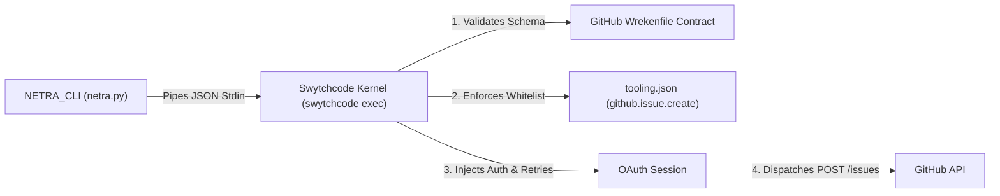

# NETRA_CLI

[](https://github.com/404Avinash/Netra_cli/actions/workflows/ci.yml)


**NETRA_CLI** (*Network & Endpoint Threat and Resilience Assessor*) is a lightweight, zero-dependency command-line utility for developers, SREs, and DevOps teams to monitor external web security configurations, prevent silent security drift, and safely dispatch regression alerts.

---

## The Problem: Silent Security Degradation

In modern development and deployment workflows, web security settings frequently degrade unnoticed:
- A reverse proxy or CDN reload accidentally drops the `Strict-Transport-Security` (HSTS) header or weakens the `Content-Security-Policy` (CSP).
- An ingress controller restart causes port 80 to stop redirecting HTTP traffic to HTTPS, exposing visitors to plaintext downgrade attacks.
- A TLS certificate draws close to expiry or is renewed with unexpected attributes.

Uptime monitors only answer *"is the site up?"*, while heavy vulnerability scanners produce 50-page PDF reports full of noise. **NETRA_CLI** provides a fast, repeatable way to track whether your critical perimeter controls remain configured as intended.

---

## Key Features

- **Zero External Dependencies:** Built entirely with Python's standard library (`urllib`, `ssl`, `socket`, `argparse`, `json`, `subprocess`). Runs anywhere Python 3 is available with sub-second execution.
- **Human-Reviewed Baselines:** Capture an intentional snapshot of verified security controls (`baseline save`) to compare future inspections against.
- **Intelligent Drift Detection:** Flags genuine security regressions (e.g., removed headers or expired certificates) while ignoring routine operational modifications (such as certificate renewals).
- **Execution Authority via Swytchcode:** Rather than scattering raw GitHub API tokens across scripts or environment variables, NETRA delegates issue dispatching to [Swytchcode](https://swytchcode.com)'s local execution kernel. You get safe previews by default and zero credential sprawl.
- **CI/CD & Scripting Ready:** Produces human-readable terminal tables or clean, structured JSON (`--json`) for automation pipelines.

---

## Monitored Security Controls

| Control | Verification Method | Status Values | Severity on Regression |
|---|---|---|---|
| **HTTP → HTTPS Redirect** | Plaintext HTTP (port 80) connection testing for permanent 301/308 redirect | `pass`, `fail`, `inconclusive` | **MEDIUM** |
| **TLS Certificate Validity** | Direct `ssl` handshake extracting `notAfter` timestamp and calculating remaining validity | `pass`, `fail`, `inconclusive` | **HIGH** (if expired) |
| **Strict-Transport-Security (HSTS)** | Inspects header and validates directives according to RFC 6797 (`max-age=0` fails) | `present`, `missing`, `inconclusive` | **MEDIUM** |
| **Content-Security-Policy (CSP)** | Checks header presence and asserts non-empty configuration | `present`, `missing`, `inconclusive` | **MEDIUM** |
| **X-Content-Type-Options** | Enforces the strict `nosniff` header value | `present`, `missing`, `inconclusive` | **LOW** |
| **Referrer-Policy** | Checks header presence and policy definition | `present`, `missing`, `inconclusive` | **LOW** |

> **Resilience Guarantee:** Network timeouts, unreachable ports, or DNS failures cleanly report `inconclusive` with a diagnostic reason—never a false `missing` or unexpected crash.

---

## Installation & Quickstart

Clone the repository and run directly:

```bash
git clone https://github.com/404Avinash/Netra_cli.git
cd Netra_cli

# Run help
python3 netra.py --help
```

---

## Usage Guide

### 1. Inspect an Endpoint (`netra check`)

Inspect a single target URL and print a formatted summary:

```bash
python3 netra.py check --target https://github.com
```

**Terminal Output:**
```text
NETRA Security Assessment for https://github.com
Observation Timestamp: 2026-11-02T15:38:02Z
==============================================================================
Control                      | Status          | Details / Value
------------------------------------------------------------------------------
HTTP -> HTTPS Redirect       | [PASS]          | HTTP 301 redirects to HTTPS: https://github.com/
TLS Certificate Validity     | [PASS]          | Valid certificate (86 days left, expires 2027-01-27T23:59:59Z, issuer: Sectigo Limited)
Strict-Transport-Security    | [PRESENT]       | max-age=31536000; includeSubdomains; preload
Content-Security-Policy      | [PRESENT]       | default-src 'none'; base-uri 'self'; ...
X-Content-Type-Options       | [PRESENT]       | nosniff
Referrer-Policy              | [PRESENT]       | origin-when-cross-origin, strict-origin-when-cross-origin
==============================================================================
```

For scripts and CI pipelines, use `--json`:
```bash
python3 netra.py check --target https://github.com --json
```

---

### 2. Save a Reviewed Baseline (`netra baseline save`)

Save the current observation as the authoritative benchmark for future comparisons:

```bash
python3 netra.py baseline save --target https://github.com --yes
# ✔ Baseline saved successfully to baselines/github.com.json
```

---

### 3. Compare Live Endpoint to Baseline (`netra compare`)

Detect whether current controls match the established baseline:

```bash
python3 netra.py compare --target https://github.com
```

**Output when configurations match:**
```text
NETRA Drift Analysis for https://github.com
Baseline Saved: 2026-11-02T15:38:13Z | Current Time: 2026-11-02T15:38:13Z
======================================================================================
Control                    | Baseline   | Current    | Status     | Severity
--------------------------------------------------------------------------------------
HTTP->HTTPS Redirect       | pass       | pass       | MATCH      | -       
TLS Certificate Validity   | pass       | pass       | MATCH      | -       
Strict-Transport-Security  | present    | present    | MATCH      | -       
Content-Security-Policy    | present    | present    | MATCH      | -       
X-Content-Type-Options     | present    | present    | MATCH      | -       
Referrer-Policy            | present    | present    | MATCH      | -       
======================================================================================

✔ No security drift detected. All controls match or exceed baseline.
```

**Output when regressions are detected (exits with code `1`):**
```text
======================================================================================
Control                    | Baseline   | Current    | Status     | Severity
--------------------------------------------------------------------------------------
HTTP->HTTPS Redirect       | pass       | fail       | DRIFT      | MEDIUM  
Strict-Transport-Security  | present    | missing    | DRIFT      | MEDIUM  
Content-Security-Policy    | present    | missing    | DRIFT      | MEDIUM  
X-Content-Type-Options     | present    | missing    | DRIFT      | LOW     
Referrer-Policy            | present    | missing    | DRIFT      | LOW     
======================================================================================

⚠ DRIFT DETECTED: 5 security regression(s) identified!

Recommended Actions:
  1. [MEDIUM] HTTP->HTTPS Redirect: Enforce permanent 301/308 redirect from HTTP to HTTPS on port 80.
  2. [MEDIUM] Strict-Transport-Security: Restore Strict-Transport-Security header (recommended: max-age=31536000; includeSubDomains).
  3. [MEDIUM] Content-Security-Policy: Restore Content-Security-Policy header to protect against XSS and content injection.
  4. [LOW] X-Content-Type-Options: Restore 'X-Content-Type-Options: nosniff' header to prevent MIME sniffing.
  5. [LOW] Referrer-Policy: Restore 'Referrer-Policy: strict-origin-when-cross-origin' header to prevent referrer leakage.
```

---

### 4. Create Issue via Swytchcode Execution Authority (`netra notify`)

When regressions occur, NETRA can file a GitHub issue directly in your tracking repository.

#### Safe Preview Mode (Default)
Running without `--confirm` displays a full markdown preview without making any network calls:

```bash
python3 netra.py notify --target https://example.com --repo 404Avinash/Netra_cli
```

#### Confirmed Dispatch
Pass `--confirm` to dispatch the issue:

```bash
python3 netra.py notify --target https://example.com --repo 404Avinash/Netra_cli --confirm
# Output: ✔ Issue created successfully via Swytchcode!
```

> **Live Example:** Inspect an issue created by this tool at [GitHub Issue #1](https://github.com/404Avinash/Netra_cli/issues/1).

---

## Architecture: Why Swytchcode?

Traditional notification scripts require generating personal access tokens (PATs), hardcoding credentials into environment files, and writing custom retry logic.

NETRA uses **Swytchcode** as an *Execution Authority Kernel*:



1. **Zero Credential Exposure:** `netra.py` contains no API keys or tokens. Swytchcode manages OAuth credentials out-of-band and injects them in flight.
2. **Contract-Governed APIs (Wrekenfiles):** The request schema is validated against declarative Wrekenfile contracts before touching the network.
3. **Principle of Least Privilege:** Only explicitly whitelisted operations in `.swytchcode/tooling.json` (`github.issue.create`) can be triggered.
4. **Built-in Resilience:** Automatic 3-attempt exponential backoff retries on rate limits (429) or transient errors (503).
5. **Local Auditability:** Every outbound dispatch is logged locally (`swytchcode audit stats`).

---

## Test Suite

NETRA includes a zero-dependency test suite mocking all network layers (`socket`, `ssl`, and HTTP):

```bash
python3 -m unittest discover -s tests -v
```

```text
Ran 39 tests in 0.118s

OK
```

---

## Continuous Integration

Every commit and pull request is automatically verified across Python 3.10, 3.11, and 3.12 via GitHub Actions. See the live build status in [GitHub Actions](https://github.com/404Avinash/Netra_cli/actions).

---

## License

This project is licensed under the MIT License.
